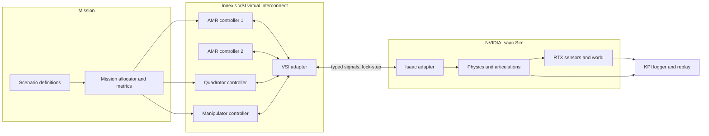

# A Time-Synchronized Innexis VSI–Isaac Sim Bridge for Validating Heterogeneous Multi-Robot Systems

## Executive summary

Heterogeneous multi-robot missions depend on distributed controllers that must cooperate across different buses, timing regimes, and physical dynamics. Current validation practice forces a trade-off. High-fidelity simulators such as NVIDIA Isaac Sim exercise realistic physics, contacts, and sensors but typically treat controller software as a monolith. Siemens Innexis VSI isolates controller clients on a virtual interconnect but relies on simplified plant models. This graduation project builds and evaluates a time-synchronized bridge between the two. Four heterogeneous agents — two differential-drive AMRs, a quadrotor, and a six-axis manipulator — execute a warehouse inspection mission. Their controllers run as isolated VSI clients; Isaac Sim supplies physics, contacts, and RTX sensor data. A DTDL-derived signal registry, a lock-step scheduler, and typed adapters connect the two environments. The project quantifies synchronization error, latency, real-time factor, mission success, and deviation from an Isaac-only baseline, and delivers an open, reproducible validation platform plus a thesis.

## Problem statement

Validating multi-robot software before deployment is expensive and risky. Physical testbeds are slow, scarce, and difficult to instrument; pure software simulation often abstracts away the very timing and bus behaviour that causes failures. Isaac Sim closes much of the physics and perception gap: it provides PhysX contact dynamics, RTX lidar and camera sensors, USD-based worlds, and multi-articulation scenes. However, in a conventional Isaac-only setup, each robot's controller runs in the same Python process or through ad hoc ROS 2 nodes. That makes it hard to isolate one controller, inject a bus fault, or observe signal-level exchanges between robots.

Innexis VSI addresses the complementary half. It provides a virtual system interconnect in which distributed clients exchange CAN frames and other signals over a defined backplane, with DTDL-based system descriptions and `vsiBuild`/`vsiSim` tooling. The course's single-robot digital-twin projects show that this works for one plant and one controller. What does not yet exist is a validated method for connecting VSI's client-level abstraction to a high-fidelity, multi-robot world model — and evidence about whether doing so preserves the conclusions a validation campaign would draw.

The cost of the gap is concrete: teams either over-invest in hardware-in-the-loop early, or accept monolithic simulations whose controller-level faults and timing effects are invisible. This project targets that middle ground.

**Scope.** In scope: simulation-only validation of four robots, one warehouse scenario family, controller and bus-level fault injection, and a quantitative comparison against an Isaac-only baseline. Out of scope: physical robot deployment, safety certification, and real ECU hardware. Sim-to-real transfer is treated as a limitation, not a claimed result.

## Objectives

1. **Build a bidirectional, time-synchronized VSI↔Isaac Sim bridge** supporting at least four concurrent robot clients. Success: lock-step drift stays within one physics step over a 10-minute run at a fixed seed; 95th-percentile bridge overhead is at most 5 ms beyond the step period. Links to M1–M2.
2. **Define and generate a typed signal contract** from DTDL definitions for at least 30 signals spanning commands, state, and sensor data, with automatic unit and coordinate-frame normalization. Success: round-trip schema tests pass for every signal, and no manual per-signal bridge code is required for a new robot of a supported class. Links to M1–M3.
3. **Demonstrate a heterogeneous mission** with two AMRs, one quadrotor, and one manipulator across nominal, degraded-sensing, and communication-fault scenarios. Success: at least 90% mission success in the nominal scenario and reproducible KPIs across five seeds. Links to M3.
4. **Quantify validation fidelity and cost** relative to an Isaac-only baseline. Success: control KPI deviation no greater than 5% under nominal conditions, with measured latency, real-time factor, and determinism reported for both configurations. Links to M4.
5. **Deliver a reproducible research artifact**: bridge, scenario suite, configuration, logs, analysis scripts, and thesis. Success: an independent reader can reproduce the headline benchmark from the repository and documented environment. Links to M5.

## Proposed architecture

The system is organized into five layers. The design keeps robot software inside VSI clients and physical simulation inside Isaac Sim, with a narrow, testable contract between them.

| Component | Responsibility | Key interfaces |
| --- | --- | --- |
| VSI clients | One control stack per robot: differential-drive AMR, quadrotor attitude/position, joint-trajectory manipulator | VSI Python client API; CAN frame IDs; control tick |
| VSI adapter | Publishes and subscribes frames; maps frames to typed signals | `vsiCommonPythonApi` (to be confirmed in M0); DTDL signal registry |
| Bridge core | Normalizes units and frames, validates schema, buffers and sequences messages | Internal typed message bus; JSON/YAML signal registry |
| Isaac adapter | Applies commands to USD articulations; reads joint states, IMU, lidar, camera | Isaac Sim Python API; USD prim paths; sensor APIs |
| Scheduler | Lock-step barrier, time scaling, seed control, run lifecycle | Clock service; per-tick barrier; timestamped logs |
| Scenario and metrics | Mission allocation, fault injection, KPI collection, replay | YAML scenarios; HDF5/MCAP logs; analysis notebooks |

**Key design choices.** First, the bridge is a separate process rather than in-process code, so a controller crash, a stalled client, or injected bus latency cannot silently corrupt the simulator. Second, time is driven by a lock-step scheduler: Isaac advances one physics step, sensor states are published, VSI clients compute, and commands are applied before the next step. A soft real-time mode supports interactive inspection, but benchmark results use lock-step. Third, the signal contract is generated from DTDL rather than hand-coded, because heterogeneous robots otherwise accumulate inconsistent frame conventions and unit assumptions. The rejected alternative — routing everything through ROS 2 topics — was set aside as the primary path because it adds a second scheduler and QoS layer between VSI and Isaac, making timing attribution harder; a ROS 2 mission layer remains an option for coordination only.

**Non-functional requirements.** Determinism under fixed seed; bounded jitter; headless operation for batch runs; observable per-signal tracing; and recovery from a dropped client without restarting the whole scenario. Coordinate frames follow ROS REP-103 conventions at the boundary, with explicit conversion to USD/Isaac conventions inside the Isaac adapter.

## Technical workflow

| Phase | Inputs | Activities and tools | Outputs | Exit criteria |
| --- | --- | --- | --- | --- |
| P1 Feasibility and contracts (weeks 1–4) | VSI environment, Isaac Sim workstation, robot descriptions | Confirm VSI API and licensing; prototype one AMR loop; measure clock drift; draft DTDL schema; build benchmark harness | Bridge spike; API constraints note; schema v0 | One AMR driven from a VSI client in Isaac for 60 s with drift ≤1 step |
| P2 Single-robot vertical slice (weeks 5–10) | Schema v0; AMR USD model | Implement VSI adapter, bridge core, Isaac adapter; CAN command/telemetry loop; deterministic replay; unit/frame tests | Working bridge; test suite; AMR scenario | 20 seeded runs reproducible; schema round-trip tests pass |
| P3 Heterogeneous fleet (weeks 11–17) | UAV and manipulator models; mission spec | Add three clients; bus segmentation and namespacing; mission allocator; sensors (IMU, lidar, camera); scenario DSL | Four-robot mission; three scenarios | Nominal mission succeeds in ≥90% of runs; no cross-robot signal leakage |
| P4 Validation and fault injection (weeks 18–23) | Baseline configurations; scenario suite | Run Isaac-only, VSI-only, and VSI+Isaac baselines; inject sensing degradation, bus delay, and client loss; ablations on sync mode and rendering | Benchmark dataset; analysis notebook | Headline metrics produced for all configurations; determinism quantified |
| P5 Thesis and dissemination (weeks 24–30) | Results; artifact | Write thesis; prepare defense and demo; clean and document repository | Thesis; demo; reproducible artifact | Thesis submitted; clean-environment reproduction succeeds |

The toolchain is deliberately conventional: Python 3.10+, the Innexis VSI 2025.x client environment (`vsiBuild`, `vsiSim`, DTDL definitions), NVIDIA Isaac Sim with its Python API and PhysX, USD assets, and standard scientific Python for analysis. Logs are stored in HDF5 or MCAP with a documented schema so results survive environment changes.

## Novelty and differentiation

- **Unlike an Isaac-only simulation**, where all controllers share a process and bus behaviour is abstracted, we run each robot's controller as an isolated VSI client over a virtual interconnect. This enables per-client fault injection, signal-level tracing, and failure containment that a monolithic scene cannot provide.
- **Unlike a VSI-only kinematic digital twin**, we close the control loop through Isaac Sim's physics, contacts, and RTX sensors. Multi-robot interaction, sensor noise, and terrain effects therefore influence the validation outcome rather than being assumed away.
- **Unlike ad hoc point-to-point bridges**, we derive a typed, unit-aware signal contract from DTDL and pair it with a lock-step scheduler, so adding a compatible robot does not require bespoke glue code.
- **The validation methodology itself is a contribution**: a benchmark that measures whether inserting VSI changes the conclusions of an Isaac-based campaign, and under which conditions it does.

The individual ingredients are established. The integration pattern, the fidelity-preservation evidence, and the heterogeneous-fleet validation are the defensible contribution.

## Milestones

| ID | Milestone | Deliverables | Exit criteria | Duration | Dependencies |
| -- | --------- | ------------ | ------------- | -------- | ------------ |
| M0 | Feasibility and environment | API constraints note; bridge spike; schema v0 | One AMR controlled from VSI in Isaac; drift measured | Weeks 1–4 | VSI and GPU access |
| M1 | Single-robot bridge | VSI/Isaac adapters; scheduler; tests | 60 s lock-step run; schema tests pass | Weeks 5–8 | M0 |
| M2 | Deterministic single-robot validation | Replay tooling; AMR benchmark | 20 seeded runs reproducible within tolerance | Weeks 9–10 | M1 |
| M3 | Heterogeneous fleet mission | UAV and manipulator clients; three scenarios | Nominal success ≥90%; no cross-bus leakage | Weeks 11–17 | M2 |
| M4 | Comparative validation | Fault-injection suite; benchmark dataset | All baselines measured; deviations reported | Weeks 18–23 | M3 |
| M5 | Thesis and artifact | Thesis; demo; documented repository | Reproduction from clean environment | Weeks 24–30 | M4 |

The plan retires the highest-risk unknown — whether VSI and Isaac can be synchronized deterministically — in M0–M1, before the heterogeneous fleet work begins.

## Risks and mitigations

| Risk | Category | Likelihood | Impact | Mitigation | Early warning | Owner |
| ---- | -------- | ---------- | ------ | ---------- | ------------- | ----- |
| VSI API or licence does not expose the required client and timing hooks | Access / technical | Medium | High | Validate in M0; agree a documented API contract with the Siemens mentor; keep a ROS 2 fallback for the transport layer | Prototype cannot observe frames or control ticks | Student + Siemens mentor |
| Clock drift or deadlock between lock-step scheduler and Isaac physics | Technical | Medium | High | Barrier-per-step design; watchdog; drift measurements from week 1; soft-sync fallback for non-benchmark runs | Growing lag or repeated timeouts under load | Student |
| GPU or Isaac Sim performance limits the four-robot scene | Platform | Medium | Medium | Headless mode; reduced rendering; level-of-detail assets; scale scene before adding robots | Real-time factor below 0.5 in P2 | Student + lab admin |
| Unit, frame, or quaternion convention errors corrupt control | Data / integration | High | Medium | Generated signal registry; explicit frame transforms; round-trip and golden-signal tests | Persistent tracking bias or mirrored motion | Student |
| Heterogeneous mission scope expands beyond the timeline | Schedule | Medium | Medium | Freeze the four-agent scenario at M3; park optional robots as stretch goals | P3 slipping past week 17 | Student + supervisor |
| Results are not reproducible across machines or versions | Reproducibility | Medium | Medium | Pin versions; containerise where licensed; record seeds and environment metadata | Benchmark variance across reruns | Student |
| Sim-to-real gap is over-interpreted | Scientific | Low | Medium | Scope claims to simulation; report fidelity limitations explicitly | Reviewer asks for hardware evidence | Student + supervisor |

## Expected results

### Outputs

- A documented, open bridge between Innexis VSI and Isaac Sim, including adapters, scheduler, and configuration.
- A DTDL-derived signal registry and schema-validation test suite covering at least 30 signals and four robot classes.
- Three scenario families and a fault-injection harness for sensor degradation, bus delay, and client loss.
- A benchmark dataset and analysis notebooks quantifying synchronization, latency, determinism, mission performance, and deviation from an Isaac-only baseline.
- A graduation thesis, a demonstration, and a reproducible repository.

### Outcomes

The project is expected to show whether VSI-in-the-loop validation can be inserted beneath a high-fidelity multi-robot simulation without changing engineering conclusions. The target is control-KPI deviation no greater than 5% under nominal conditions, with the cost reported as latency and real-time factor. If the bridge preserves conclusions while enabling per-client isolation and fault injection, it gives teams a practical intermediate between monolithic simulation and hardware-in-the-loop. Readiness is a research prototype, not a production tool.

### Evaluation plan

Three configurations are compared: **B1** Isaac-only controllers, **B2** VSI with the existing simplified kinematic plant, and **B3** the proposed VSI+Isaac bridge. Metrics cover control tracking error, settling time, and overshoot; mission completion, makespan, coverage, and collisions; synchronization error, end-to-end latency (p50/p95), missed deadlines, real-time factor, and KPI variance across seeds. Ablations vary lock-step versus soft sync, rendering on/off, bus load, and fleet size. Acceptance uses the thresholds stated in the objectives. The hypothesis is falsified if lock-step cannot be sustained or if B3 deviates from B1 by more than 10% on the primary control KPIs; either outcome will be reported with the conditions that produced it.

## Assumptions and open questions

**Assumptions**

- The university provides access to the Innexis VSI 2025.x environment and a GPU workstation capable of running Isaac Sim.
- VSI exposes a Python client API, a virtual CAN backplane, and DTDL-based system descriptions, consistent with the course's existing single-robot projects.
- Usable USD models exist for the AMRs, quadrotor, and manipulator; otherwise simplified models will be built and their fidelity limitations documented.
- The project runs for approximately 30 weeks with one student and two supervisors, and is simulation-only.
- The primary audience is a graduation committee with Siemens technical reviewers; the proposal is written for both.

**Open questions**

1. Which VSI release and licence terms apply, and is `vsiCommonPythonApi` the supported integration surface?
2. Which Isaac Sim version and GPU will be available, and is there a shared lab image?
3. Are validated robot models available, or is modelling part of the project scope?
4. Should mission allocation run in ROS 2 or as another VSI client?
5. Is any hardware-in-the-loop validation expected, or is simulation-only acceptable?
6. What thesis format and defense date should the milestones target?
